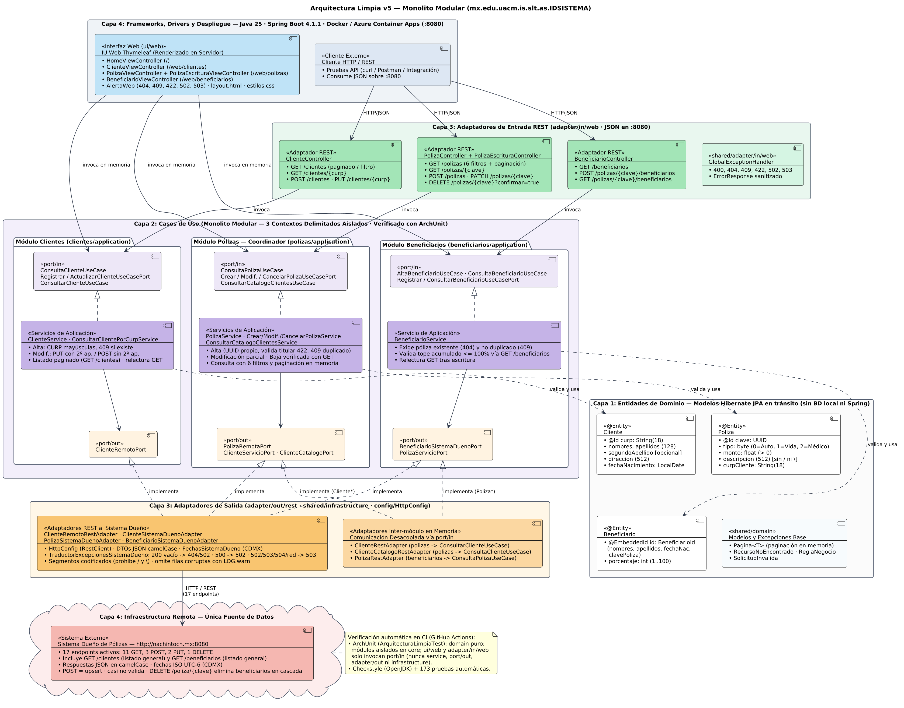

# Documento de Acompañamiento de la Vista Arquitectónica (`arquitectura5`)

- **Producto:** Sistema Intermediario de Pólizas de Seguro (`mx.edu.uacm.is.slt.as.IDSISTEMA`)
- **Versión del Producto y de la Vista:** `v1.0.0` (Entrega Final) — Vista **`arquitectura5`**
- **Equipo:** `404 Equipo no Encontrado` — UACM San Lorenzo Tezonco, Arquitectura de Software (`2026-II`)
- **Diagrama asociado:** [`docs/arquitectura5.puml`](arquitectura5.puml) / [`docs/arquitectura5.png`](arquitectura5.png)
- **Marco de referencia:** ISO/IEC/IEEE 42010 (Descripción de Arquitectura), ISO/IEC/IEEE 29148:2018 (ERS), SWEBOK v4.0 y **Reactivo 3.6** (documentación complementaria de vistas arquitectónicas).

---

## 1. Necesidades de los Interesados (*Stakeholders* y *Concerns*)

De acuerdo con la ERS (`docs/ERS_Sistema_Intermediario_Polizas.pdf`) y el alcance del prototipo, se identificaron cinco grupos de interesados cuyas preocupaciones (*concerns*) guían directamente las capas, límites modulares y mecanismos de verificación mostrados en `arquitectura5`:

| Interesado (*Stakeholder*) | Preocupaciones clave (*Concerns*) | Requisitos ERS asociados | Cómo lo responde la vista `arquitectura5` |
|---|---|---|---|
| **Aseguradoras cliente** (patrocinador y cliente del negocio) | Integridad de la información en el Sistema Dueño (evitar sobrescrituras silenciosas por *upsert*, garantizar suma de beneficiarios ≤ 100%, no duplicar bases de datos locales) y continuidad operativa ante fallos remotos. | Req. 1–7, 8, 10, 11 | Capa 1 con modelos Hibernate JPA en tránsito (sin BD local); Capa 2 valida precondiciones (`404`, `409`, `422`), tope acumulado vía `GET /beneficiarios` y relee con `GET` tras cada escritura; Capa 3 traduce fallos a `502`/`503`. |
| **Clientes asegurados y agentes usuarios finales** | Operar los 8 casos de uso desde navegador de forma intuitiva, consultar pólizas con los 6 filtros y paginación, evitar borrados accidentales en cascada y recibir mensajes claros ante errores sin jerga técnica. | Req. 4, 7, 9, 10, 11, 14–19 | Capa 4 (`ui/web`) expone vistas Thymeleaf unificadas (`/`, `/web/clientes`, `/web/polizas`, `/web/beneficiarios`), confirmación explícita de baja con aviso de cascada y componente `AlertaWeb` para alertas sanitizadas `404/409/422/502/503`. |
| **Equipo de desarrollo (`404 Equipo no Encontrado`)** | Trabajar en paralelo por módulo sin colisiones, mantener bajo acoplamiento entre `clientes`, `polizas` y `beneficiarios`, y asegurar cumplimiento estricto de Java 25, Spring Boot 4.1.1 y estilo de código. | Req. 12, 13 | Monolito Modular en Capa 2 con 3 contextos delimitados aislados, inversión de dependencias explícita (`port/in`, `port/out`), comunicación inter-módulo mediante adaptadores dedicados y verificación automática con **ArchUnit** y **Checkstyle**. |
| **Docente / Evaluador y aseguramiento de calidad (QA / CI)** | Trazabilidad demostrable entre requisitos, diagrama arquitectónico y código real; verificación automatizada de reglas de dependencia, validaciones de seguridad y pruebas de integración. | Req. 1–19, S2-5, S3-5, S3-6 | Cada componente del diagrama corresponde 1:1 con paquetes y clases existentes; CI en GitHub Actions ejecuta `checkstyle:check` y `verify` (173 pruebas: dominio, servicios, `MockRestServiceServer`, `@WebMvcTest` y `ArquitecturaLimpiaTest`). |
| **Operación, Integradores del Sistema Dueño y Despliegue en Nube** | Cumplir exactamente el contrato HTTP de los 17 endpoints de `http://nachintoch.mx:8080` (rutas codificadas, fechas UTC-6 CDMX, tolerancia a datos corruptos de terceros) y desplegar de forma reproducible y ligera. | Req. 8, 10, 11, 12, 13 | Capa 3 de salida concentra `HttpConfig`, `FechasSistemaDueno`, `TraductorExcepcionesSistemaDueno` y filtrado fila por fila con `LOG.warn`; Capa 4 contempla empaquetado Docker multi-etapa (JRE 25) para Azure Container Apps en `:8080`. |

---

## 2. Gestión de Decisiones Arquitectónicas (ADRs)

Las decisiones estructurales que dieron origen a la arquitectura vigente se registran a continuación en formato *Architecture Decision Record* (ADR), dejando trazabilidad de su motivación, alternativas descartadas y consecuencias:

### ADR-01 — Estilo Arquitectónico: Monolito Modular con Arquitectura Limpia
- **Contexto:** El sistema integra 3 dominios relacionados (`clientes`, `polizas`, `beneficiarios`) desarrollados en paralelo por 8 integrantes dentro de un ciclo académico acotado, con necesidad de aislamiento de reglas de negocio y facilidad de despliegue.
- **Decisión:** Adoptar un **Monolito Modular** con **Arquitectura Limpia** en 4 capas (Capa 1 `domain`, Capa 2 `application`, Capa 3 `adapter`, Capa 4 `ui/web` y `config`), encapsulando cada dominio en su propio paquete raíz con puertos `port/in` y `port/out`.
- **Alternativas descartadas:**
  - *Microservicios independientes:* sobrecarga innecesaria de red, despliegue y latencia para un prototipo intermediario sin BD propia.
  - *Arquitectura en 3 capas clásica:* tiende a acoplar controladores, lógica de negocio y detalles HTTP del Sistema Dueño.
- **Consecuencias:** Permite despliegue en un único `.jar` / contenedor (`:8080`), facilita pruebas unitarias sin Spring y permite validar automáticamente las fronteras con `ArquitecturaLimpiaTest` (ArchUnit). Como compromiso, exige disciplina para cruzar fronteras solo mediante puertos.

### ADR-02 — Persistencia en Tránsito con Modelos Hibernate JPA (sin BD local)
- **Contexto:** El Sistema Dueño (`http://nachintoch.mx:8080`) es la única fuente autorizada de datos; el objetivo del curso también requiere modelar las entidades de negocio con anotaciones JPA/Hibernate.
- **Decisión:** Definir `Cliente` (`@Entity`, `@Id curp`), `Poliza` (`@Entity`, `@Id clave`) y `Beneficiario` (`@Entity`, `@EmbeddedId BeneficiarioId`) usando `jakarta.persistence` exclusivamente en tránsito, sin configurar base de datos local ni repositorios JPA.
- **Alternativas descartadas:** Mantener una caché o BD relacional local (introduciría desincronización respecto a otros equipos que operan sobre el mismo servidor remoto).
- **Consecuencias:** Cero riesgo de datos obsoletos locales; todas las validaciones de invariantes residen en los constructores de Capa 1 (libres de dependencias de Spring).

### ADR-03 — Comunicación Inter-módulo en Memoria vía Puertos de Entrada
- **Contexto:** `polizas` necesita verificar que exista la CURP titular y listar el catálogo de clientes para el selector de alta; `beneficiarios` necesita verificar que exista la póliza asociada.
- **Decisión:** Mantener los núcleos (`domain` y `application`) aislados entre sí e implementar la comunicación inter-módulo en Capa 3 (`adapter/out/rest`) mediante adaptadores en memoria (`ClienteRestAdapter`, `ClienteCatalogoRestAdapter` y `PolizaRestAdapter`) que invocan únicamente los `port/in` del módulo destino.
- **Alternativas descartadas:** Llamadas HTTP *loopback* a `localhost:8080` (añaden latencia, serialización innecesaria y riesgo de agotamiento de hilos) o importación directa entre servicios (viola el aislamiento modular en ArchUnit).
- **Consecuencias:** Conserva la regla de aislamiento modular (`CLIENTES_DOMAIN_AISLADO`, `POLIZAS_CORE_AISLADO`, `BENEFICIARIOS_CORE_AISLADO`) y permite evolucionar cualquier módulo a un servicio separado sin tocar Capa 1 ni Capa 2.

### ADR-04 — IU Web Thymeleaf (`ui/web`) Invocando `port/in` en Memoria y Conviviendo con API REST
- **Contexto:** En la versión `arquitectura4` se había dibujado la IU Web (`ui/web`) consumiendo la API REST propia por HTTP. Al implementar la Capa 4 y la regla ArchUnit `UI_WEB_SOLO_INVOCA_PUERTOS_DE_ENTRADA`, se confirmó que los `*ViewController` deben invocar directamente los casos de uso (`port/in`) sin depender de `adapter`, `service` ni `infrastructure`. Además, los controladores REST ya ocupan `/clientes`, `/polizas` y `/beneficiarios`.
- **Decisión:** Ubicar todos los controladores Thymeleaf (`HomeViewController`, `ClienteViewController`, `PolizaViewController`, `PolizaEscrituraViewController`, `BeneficiarioViewController`) en `ui/web` bajo el prefijo **`/web/*`** (más `/` para inicio), invocando directamente `port/in` en memoria, y manejar errores de interfaz mediante `AlertaWeb` (sin dejar que `GlobalExceptionHandler` devuelva JSON al navegador).
- **Alternativas descartadas:** Consumir la propia API REST con `RestClient` desde los ViewControllers (doble salto HTTP innecesario y acoplamiento con DTOs REST) o mezclar rutas `/clientes` por negociación de contenido (`Accept: text/html`), propenso a conflictos con formularios `POST`.
- **Consecuencias:** Separación limpia entre canal HTML (`/web/*`) y canal JSON (`/clientes`, `/polizas`, `/beneficiarios`), cero ambigüedades de mapeo en Spring MVC y cumplimiento estricto de ArchUnit.

### ADR-05 — Compensación Arquitectónica ante los 24 Hallazgos del Sistema Dueño (17 Endpoints)
- **Contexto:** Las pruebas empíricas contra `http://nachintoch.mx:8080` documentaron 24 comportamientos atípicos (catálogo en [`docs/catalogo-endpoints-y-hallazgos.md`](catalogo-endpoints-y-hallazgos.md)), además de la incorporación posterior de `GET /clientes` y `GET /beneficiarios` (pasando de 15 a 17 endpoints).
- **Decisión:** Encapsular cada restricción remota en la capa correspondiente:
  1. **Capa 2 (Casos de uso):** consulta previa antes de crear (`409` contra *upsert* silencioso), verificación de existencia previa en modificaciones/bajas (`404`), cálculo de suma acumulada ≤ 100% en `BeneficiarioService` mediante `GET /beneficiarios`, paginación en memoria (`Pagina<T>`) sobre `GET /clientes` y `GET /polizas`, y relectura `GET` tras cada escritura.
  2. **Capa 3 (Adaptadores de salida):** `ClienteSistemaDuenoAdapter` elige `PUT` con 2º apellido y `POST` sin 2º apellido (Hallazgo 8); `FechasSistemaDueno` convierte timestamps UTC ↔ `America/Mexico_City`; `TraductorExcepcionesSistemaDueno` distingue `500` remoto → `502` de red/timeout/`502-504` → `503`; los listados omiten filas corruptas de otros equipos con `LOG.warn` (Hallazgo 16); se prohíben `/` y `\` antes de invocar al servidor (Hallazgo 12).
- **Consecuencias:** Aísla al dominio y a la IU de las inconsistencias del servidor legado, garantizando respuestas deterministas (`200/201/204/400/404/409/422/502/503`).

### ADR-06 — Empaquetado Contenerizado Multi-etapa y Calidad Continua en CI
- **Contexto:** El sistema debe desplegarse en la nube (Azure Container Apps) manteniendo una imagen ligera con Java 25 y asegurando que ningún cambio rompa estilo ni arquitectura.
- **Decisión:** Mantener CI en GitHub Actions (`.github/workflows/ci.yml`) ejecutando `checkstyle:check` y `verify` en cada PR hacia `desarrollo` y `main`, junto con un `Dockerfile` multi-etapa (`maven:3.9-eclipse-temurin-25` → `eclipse-temurin:25-jre`) y `.dockerignore` excluyendo artefactos, documentación y credenciales.
- **Consecuencias:** Imagen de ejecución reducida solo con JRE 25, despliegues repetibles y garantía automática de calidad antes de integrar código.

---

## 3. Revisión de Vistas (Evolución y Consistencia Diagrama ↔ Código)

### 3.1 Hallazgos detectados al revisar `arquitectura4` y correcciones en `arquitectura5`

Durante la revisión de cierre del Sprint 3 se contrastaron `docs/arquitectura4.puml`, `docs/arquitectura4.png` y el código real en el repositorio, encontrando **cinco discrepancias** que se corrigieron en **`arquitectura5.puml` / `arquitectura5.png`**:

1. **Imagen desactualizada respecto a los 17 endpoints:** `arquitectura4.png` aún mostraba el texto obsoleto *"15 endpoints (9 GET...)"* y *"Sin endpoints para listar clientes ni beneficiarios"*. En `arquitectura5` se eliminó esa nota y se documentan los **17 endpoints** (`11 GET, 3 POST, 2 PUT, 1 DELETE`) incluyendo explícitamente `GET /clientes` y `GET /beneficiarios`.
2. **Dirección errónea de dependencia desde la IU Web:** `arquitectura4` conectaba `UI --HTTP--> Capa 3 (REST)`. En el sistema implementado —y exigido por `ArquitecturaLimpiaTest`— `ui/web` invoca directamente los `port/in` de Capa 2 en memoria, mientras que un cliente HTTP externo consume la API REST de Capa 3. `arquitectura5` refleja ambos flujos con fidelidad.
3. **Clases reales omitidas o con nombres previos:** Se incorporaron `PolizaEscrituraController`, `PolizaEscrituraViewController`, `AlertaWeb`, `GlobalExceptionHandler`, `ClienteRemotoRestAdapter`, `ClienteCatalogoRestAdapter` y `ConsultarCatalogoClientesService`, y se corrigieron los nombres reales de adaptadores inter-módulo (`ClienteRestAdapter`, `PolizaRestAdapter`).
4. **Tipos de dominio desfasados:** En `arquitectura4` la entidad `Poliza` aparecía con `TipoPoliza` y `BigDecimal(9,2)`, cuando la entidad real `Poliza.java` utiliza `tipo: byte (0=Auto, 1=Vida, 2=Médico)` y `monto: float (> 0)`. Corregido en `arquitectura5`.
5. **Legibilidad del diagrama:** En `arquitectura4.png` las flechas de retorno de adaptadores inter-módulo cruzaban todo el diagrama y reducían la legibilidad del texto. En `arquitectura5.png` se reorganizó Capa 1 en cuadrícula compacta 2×2, se usaron estereotipos `<<port/in>>` y `<<port/out>>` sin solapamiento de íconos y se renderizó a `160 DPI` sin cortes ni superposiciones.

### 3.2 Matriz de verificación Diagrama (`arquitectura5`) ↔ Implementación y Pruebas

| Elemento en `arquitectura5` | Paquete / Artefacto real en el repositorio | Verificación automatizada |
|---|---|---|
| Capa 4 — IU Web Thymeleaf (`ui/web`) | `ui/web/{Home,Cliente,Poliza,PolizaEscritura,Beneficiario}ViewController`, `AlertaWeb`, `templates/`, `static/css/estilos.css` | 5 suites `@WebMvcTest` (`*ViewControllerTest`) + regla ArchUnit `UI_WEB_SOLO_INVOCA_PUERTOS_DE_ENTRADA` |
| Capa 3 Entrada — API REST (`adapter/in/web`) | `{clientes,polizas,beneficiarios}/adapter/in/web/*Controller`, `shared/adapter/in/web/GlobalExceptionHandler` | `ClienteControllerTest`, `PolizaControllerTest`, `BeneficiarioControllerTest`, `GlobalExceptionHandlerTest` + `ADAPTADORES_WEB_NO_INVOCAN_SERVICIOS_CONCRETOS` |
| Capa 2 — Casos de Uso (`application`) | `{clientes,polizas,beneficiarios}/application/{port/in,port/out,service}` | `ClienteServiceTest`, `PolizaServiceTest`, `BeneficiarioServiceTest` + `APPLICATION_NO_DEPENDE_DE_ADAPTADORES` y aislamiento por módulo |
| Capa 1 — Dominio (`domain`) | `Cliente`, `Poliza`, `Beneficiario`, `BeneficiarioId`, `Pagina<T>` y excepciones de dominio | `ClienteTest`, `PolizaTest`, `BeneficiarioTest` + `DOMAIN_NO_DEPENDE_DE_SPRING` |
| Capa 3 Salida — Adaptadores REST e Inter-módulo | `*SistemaDuenoAdapter`, `ClienteRemotoRestAdapter`, `ClienteRestAdapter`, `ClienteCatalogoRestAdapter`, `PolizaRestAdapter`, `FechasSistemaDueno`, `TraductorExcepcionesSistemaDueno` | `*SistemaDuenoAdapterTest` (`MockRestServiceServer`), `ClienteRestAdapterTest`, `PolizaRestAdapterTest`, `TraductorExcepcionesSistemaDuenoTest` |
| Capa 4 — Despliegue y CI | `Dockerfile`, `.dockerignore`, `.github/workflows/ci.yml`, `config/checkstyle/checkstyle.xml` | GitHub Actions (`checkstyle:check` + `verify` con 173 pruebas en verde y 0 violaciones) |

---

## 4. Evaluación del Formato de la Vista Arquitectónica

La vista se elaboró en **PlantUML (`.puml`) con notación de componentes UML 2**, compilada a **PNG de alta resolución (`160 DPI`)** y acompañada por documentación estructurada en **Markdown**. A continuación se evalúa formalmente la idoneidad de este formato para el proyecto:

| Criterio de evaluación | Calificación | Fortalezas del formato elegido | Limitaciones identificadas y mitigación |
|---|---|---|---|
| **Expresividad arquitectónica** | Alta | Permite representar capas concéntricas/jerárquicas, contextos delimitados (`package`), interfaces/puertos (`<<port/in>>`, `<<port/out>>`), entidades JPA y dirección exacta de dependencias (inversión de dependencias `.up.\|>`). | Al ser una vista estructural estática, no detalla secuencias temporales paso a paso (p. ej. relectura `GET` tras `POST`). **Mitigación:** se complementa con los 11 documentos de casos de uso en `docs/casos-de-uso/` y `docs/catalogo-endpoints-y-hallazgos.md`. |
| **Mantenibilidad y control de versiones (*Diagram-as-Code*)** | Muy alta | Al escribirse en texto plano (`.puml`), cada cambio arquitectónico (como el paso de `v4` a `v5`) queda versionado en Git con *diffs* revisables en Pull Requests, evitando la pérdida de archivos editables propietarios. | Requiere regenerar el `.png` cada vez que se edita el `.puml` (justo el error ocurrido en `v4`). **Mitigación:** incluir la revisión visual del `.png` renderizado como criterio obligatorio en los PRs de documentación. |
| **Claridad y legibilidad visual** | Alta | Codificación cromática consistente por capa (azul Capa 4 IU, verde Capa 3 entrada, morado Capa 2 aplicación, blanco Capa 1 dominio, ámbar Capa 3 salida, rosa Sistema Dueño), tipografía sans-serif clara y resolución `160 DPI` apta para pantalla y PDF. | PlantUML usa motor de layout automático (Graphviz), por lo que diagramas con muchos nodos pueden generar cruces si no se restringe la geometría. **Mitigación:** agrupación en cuadrícula compacta y eliminación de aristas redundantes de largo recorrido. |
| **Accesibilidad para distintos interesados** | Alta | El `.png` se visualiza directamente en GitHub, navegadores, presentaciones y PDFs sin instalar herramientas; el `.puml` y este `.md` se abren en cualquier editor de texto. | Los interesados no técnicos pueden encontrar densos los nombres exactos de clases Java. **Mitigación:** los títulos de capas y las secciones 1 y 2 de este documento traducen cada bloque técnico a impacto de negocio y requisitos ERS. |
| **Trazabilidad con estándares y el código** | Muy alta | Alinea la vista estructural con la taxonomía de ISO/IEC/IEEE 42010 (interesados, preocupaciones, decisiones y correspondencia con la implementación) y con las reglas ejecutables de ArchUnit. | No reemplaza una vista de despliegue de infraestructura en nube cuando el sistema escale a múltiples réplicas o balanceadores. **Mitigación:** en caso de evolucionar más allá del prototipo en Azure Container Apps, conviene añadir una vista de despliegue complementaria (`Deployment Diagram`). |

### Conclusión de la evaluación
El formato **PlantUML (UML 2 de componentes) + PNG (`160 DPI`) + acompañamiento en Markdown** resulta **altamente adecuado** para el prototipo `IDSISTEMA`: maximiza la trazabilidad con el código real, permite auditar cambios en Git y cubre las necesidades de comunicación tanto del equipo técnico como de la evaluación académica. La principal recomendación operativa es mantener siempre sincronizados `.puml` y `.png` en el mismo commit ante cualquier cambio arquitectónico futuro.
