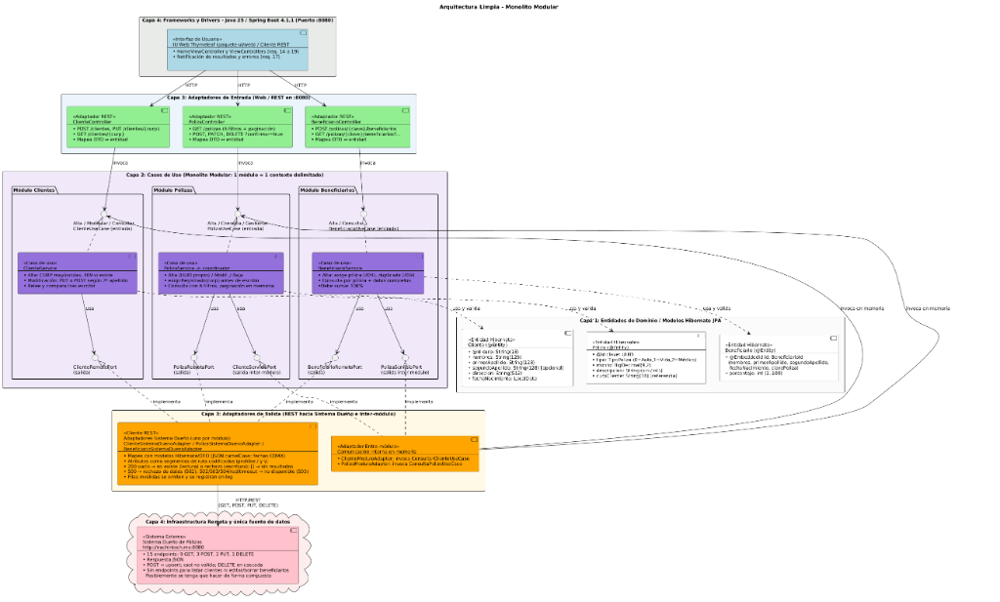

# Guía Técnica y Especificación de Diseño — Práctica 2

Documento de referencia para todo el equipo (**404 Equipo no Encontrado**). Concentra la estructura oficial del proyecto, el diagrama de arquitectura limpia, las reglas derivadas de las pruebas al Sistema Dueño y la especificación técnica de los endpoints y consultas.

---

## 1. Diagrama de Arquitectura (`arquitectura4`)



### Decisiones de arquitectura para este hito
1. **Monolito Modular con Arquitectura Limpia**: Los 3 contextos delimitados (`clientes`, `polizas`, `beneficiarios`) viven en un mismo proyecto ejecutable de Spring Boot (`:8080`), aislados mediante puertos de entrada (`port/in`) y puertos de salida (`port/out`).
2. **Modelos con Hibernate JPA (Objetivo 2.4.2)**: Las entidades de Capa 1 (`Cliente`, `Poliza`, `Beneficiario` y `BeneficiarioId`) usan las anotaciones de `jakarta.persistence` (`@Entity`, `@Id`, `@Embeddable`, `@EmbeddedId`) para mapear hacia y desde el Sistema Dueño, operando 100% en tránsito (sin base de datos local).
3. **Comunicación entre módulos en memoria**: `PolizaService` valida al titular mediante su puerto de salida `ClienteServicioPort` (implementado por `ClienteModuloAdapter`, que invoca `ConsultarClienteUseCase` en memoria). De igual forma, `BeneficiarioService` valida la póliza mediante `PolizaServicioPort` (`PolizaModuloAdapter` → `ConsultaPolizaUseCase`).
4. **Regla de Dependencia verificada con ArchUnit (`ArquitecturaLimpiaTest`)**:
   - `domain` no importa nada de Spring (`org.springframework..`), `application`, `adapter` ni `ui`.
   - `application` solo conoce `domain` (nunca `adapter`, `ui` ni `org.springframework.web..`).
   - El núcleo (`domain` y `application`) de cada módulo no importa clases de los otros módulos.

---

## 2. Estructura de Carpetas

```text
ProyectoAQS_26-II/
├── .github/
│   ├── workflows/ci.yml                → CI de GitHub Actions (Checkstyle + verify)
│   └── CODEOWNERS
├── .mvn/ , mvnw, mvnw.cmd              → Maven Wrapper
├── config/checkstyle/
│   └── checkstyle.xml                  → Reglas de estilo Checkstyle 14.3.0
├── docs/                               → Diagrama PlantUML, guía técnica, ERS y catálogo de endpoints
├── pom.xml                             → Spring Boot 4.1.1, Java 25, WebMVC, Thymeleaf, Hibernate, ArchUnit
└── src/
    ├── main/
    │   ├── java/
    │   │   └── mx/edu/uacm/is/slt/as/IDSISTEMA/
    │   │       ├── Application.java                   (Clase @SpringBootApplication)
    │   │       │
    │   │       ├── clientes/                          (Módulo Clientes)
    │   │       │   ├── domain/
    │   │       │   │   ├── model/Cliente.java         (@Entity, @Id curp, reglas de validación)
    │   │       │   │   └── exception/                 (ClienteNoEncontradoException, CurpInvalidaException)
    │   │       │   ├── application/
    │   │       │   │   ├── port/
    │   │       │   │   │   ├── in/                    (AltaClienteUseCase, ConsultarClienteUseCase, ModificarClienteUseCase)
    │   │       │   │   │   └── out/                   (ClienteRemotoPort)
    │   │       │   │   └── service/ClienteService.java
    │   │       │   └── adapter/
    │   │       │       ├── in/web/                    (ClienteController, DTOs y Mappers)
    │   │       │       └── out/rest/                  (ClienteSistemaDuenoAdapter, DTOs camelCase remoto)
    │   │       │
    │   │       ├── polizas/                           (Módulo Pólizas - Coordinador)
    │   │       │   ├── domain/
    │   │       │   │   ├── model/                     (Poliza.java [@Entity, @Id clave], TipoPoliza.java [0,1,2])
    │   │       │   │   └── exception/                 (PolizaNoEncontradaException, MontoInvalidoException)
    │   │       │   ├── application/
    │   │       │   │   ├── port/
    │   │       │   │   │   ├── in/                    (AltaPolizaUseCase, ConsultaPolizaUseCase, GestionarPolizaUseCase)
    │   │       │   │   │   └── out/
    │   │       │   │   │       ├── PolizaRemotaPort.java
    │   │       │   │   │       └── ClienteServicioPort.java (exigirRegistrado(curp))
    │   │       │   │   └── service/PolizaService.java
    │   │       │   └── adapter/
    │   │       │       ├── in/web/                    (PolizaController, DTOs)
    │   │       │       └── out/rest/
    │   │       │           ├── PolizaSistemaDuenoAdapter.java
    │   │       │           └── ClienteModuloAdapter.java (o ClienteRestAdapter en memoria)
    │   │       │
    │   │       ├── beneficiarios/                     (Módulo Beneficiarios)
    │   │       │   ├── domain/
    │   │       │   │   ├── model/                     (Beneficiario.java [@Entity, @EmbeddedId], BeneficiarioId.java [@Embeddable])
    │   │       │   │   └── exception/                 (BeneficiarioNoEncontradoException, PorcentajeInvalidoException)
    │   │       │   ├── application/
    │   │       │   │   ├── port/
    │   │       │   │   │   ├── in/                    (AltaBeneficiarioUseCase, ConsultaBeneficiarioUseCase)
    │   │       │   │   │   └── out/
    │   │       │   │   │       ├── BeneficiarioRemotoPort.java
    │   │       │   │   │       └── PolizaServicioPort.java
    │   │       │   │   └── service/BeneficiarioService.java
    │   │       │   └── adapter/
    │   │       │       ├── in/web/                    (BeneficiarioController, DTOs)
    │   │       │       └── out/rest/
    │   │       │           ├── BeneficiarioSistemaDuenoAdapter.java
    │   │       │           └── PolizaModuloAdapter.java (o PolizaRestAdapter en memoria)
    │   │       │
    │   │       ├── shared/                            (Componentes transversales)
    │   │       │   ├── domain/exception/              (ReglaNegocioException, RegistroDuplicadoException [409])
    │   │       │   ├── infrastructure/
    │   │       │   │   ├── http/                      (FechasSistemaDueno.java, RestClientConfig.java)
    │   │       │   │   └── exception/                 (SistemaDuenoNoDisponibleException [503], SistemaDuenoRechazoException [502])
    │   │       │   └── adapter/in/web/                (GlobalExceptionHandler.java)
    │   │       │
    │   │       └── ui/                                Capa 4 / Interfaz Web
    │   │           └── web/
    │   │               ├── HomeViewController.java    (Mapea a "/" y menú de los 8 casos de uso)
    │   │               ├── ClienteViewController.java
    │   │               ├── PolizaViewController.java
    │   │               └── BeneficiarioViewController.java
    │   │
    │   └── resources/
    │       ├── application.yml                        (URL nachintoch.mx:8080, timeouts, server.port)
    │       ├── templates/
    │       │   ├── index.html                         (Menú general ejecutable con los 8 casos de uso)
    │       │   ├── clientes/
    │       │   ├── polizas/
    │       │   └── beneficiarios/
    │       └── static/css/
    │
    └── test/java/mx/edu/uacm/is/slt/as/IDSISTEMA/
        ├── clientes/domain/ClienteTest.java
        ├── polizas/domain/PolizaTest.java
        ├── polizas/application/PolizaServiceTest.java
        ├── beneficiarios/domain/BeneficiarioTest.java
        └── architecture/ArquitecturaLimpiaTest.java
```

---

## 3. Reglas por Caso de Uso, Criterios de Aceptación.

| Caso de uso | Antes de escribir | Escritura hacia Sistema Dueño | Después de escribir |
|---|---|---|---|
| **Alta de Cliente** | Exigir CURP en mayúsculas. Buscar en mayúsculas y minúsculas: si existe, lanzar `409 Conflict` (`RegistroDuplicadoException`). | `POST` | Releer con `GET` y comparar. |
| **Modificación de Cliente** | Buscar cliente: si no existe, lanzar `404` (`ClienteNoRegistradoException`). | `PUT` si tiene segundo apellido; `POST` si no tiene segundo apellido (el `PUT` sin 2º apellido da 500 en el servidor remoto). | Releer con `GET` y comparar. |
| **Alta de Póliza** | `exigirRegistrado(curp)` (si no existe → 422), generar `UUID.randomUUID()` propio. | `POST` | Releer con `GET` y comparar. |
| **Modificación de Póliza** | Leer la póliza actual (`404` si no existe), completar los campos en `null` (modificación parcial) y, si cambia el titular, `exigirRegistrado(curp)`. | `PUT` | Releer con `GET` y comparar. |
| **Baja de Póliza** | Exigir `?confirmar=true` en el controlador (`400` si falta). Verificar que la póliza existe (`404` si no). | `DELETE` | Verificar con `GET` que ya no existe. Avisar en interfaz que borra beneficiarios en cascada. |
| **Alta de Beneficiario** | `exigirExiste(poliza)` (`404` si no existe) y verificar si el beneficiario ya existe (`409`). Validar porcentaje `1..100` en el dominio. | `POST` | Releer con `GET` y comparar. |
| **Consultas (`GET`)** | Validar que los parámetros requeridos no estén vacíos y no contengan `/` ni `\`. | `GET` directo | Omitir y registrar en `log.warn` las filas basura de otros equipos. `[]` significa "sin resultados". |

---

## 4. Mapa de la API REST Propia (`:8080`)

| Endpoint | Éxito | Errores propios |
|---|---|---|
| `POST /clientes` | `201 Created` | `409` (ya existe), `422` (datos inválidos) |
| `PUT /clientes/{curp}` | `200 OK` | `404` (no registrado), `422` |
| `GET /clientes/{curp}` | `200 OK` | `404` (no registrado) |
| `POST /polizas` | `201 Created` + `Location` | `422` (datos inválidos o cliente no registrado) |
| `PATCH /polizas/{clave}` | `200 OK` | `404`, `422` |
| `DELETE /polizas/{clave}?confirmar=true` | `204 No Content` | `400` (sin confirmar), `404` |
| `GET /polizas/{clave}` | `200 OK` | `404` |
| `GET /polizas` (con filtro opcional: `curp`, `tipo` o `fechaNacimientoBeneficiario`) | `200 OK` (lista/página; puede venir vacía) | `400` (más de un filtro), `422` |
| `GET /polizas/busqueda/cliente?nombres&primerApellido[&segundoApellido]` | `200 OK` | `400` (falta parámetro obligatorio), `422` |
| `GET /polizas/busqueda/beneficiario?nombres&primerApellido[&segundoApellido]` | `200 OK` | `400` (falta parámetro obligatorio), `422` |
| `POST /polizas/{clave}/beneficiarios` | `201 Created` | `404` (póliza), `409` (duplicado), `422` |
| `GET /polizas/{clave}/beneficiarios?nombres&primerApellido[&segundoApellido]&fechaNacimiento` | `200 OK` | `404` |

### Códigos de error comunes a todos los endpoints
- **`400 Bad Request`**: JSON mal formado, UUID o fecha ilegibles, o falta de parámetro requerido.
- **`404 Not Found`**: Recurso no encontrado (cuando el Sistema Dueño devuelve `200` con cuerpo vacío en lectura).
- **`409 Conflict`**: Intento de dar de alta un registro cuya llave ya existe.
- **`422 Unprocessable Entity`**: Violación de regla de dominio (CURP, monto, porcentaje, barra `/` o `\` en ruta, o cliente titular no registrado).
- **`502 Bad Gateway`**: El Sistema Dueño rechazó la operación (cuerpo vacío en escritura o HTTP `500` por rechazo de datos) o devolvió datos inconsistentes tras releer.
- **`503 Service Unavailable`**: El Sistema Dueño no está disponible (HTTP `502`, `503`, `504`, timeout o fallo de conexión).

---

## 5. Especificación de Consultas GET de Pólizas (Prioritario — 15 pts)

### Endpoints del Módulo de Pólizas

| Endpoint propio (`:8080`) | Endpoint remoto (`nachintoch.mx:8080`) | Respuesta |
|---|---|---|
| `GET /polizas/{clave}` | `GET /poliza/{clave}` | `200` · `404` si llega `200` vacío · `400` si el UUID es ilegible |
| `GET /polizas?pagina&tamano` (sin filtro) | listado de pólizas | `200 Pagina` |
| `GET /polizas?curp=…` | `GET /polizas/{curp}` | `200 Pagina` (`[]` → página vacía) |
| `GET /polizas?tipo=0\|1\|2` | `GET /polizas/{tipo}` | `200` · `422` si el tipo no es `0..2` |
| `GET /polizas?fechaNacimientoBeneficiario=yyyy-MM-dd` | según catálogo de 15 endpoints | `200` |
| `GET /polizas/busqueda/cliente?nombres&primerApellido[&segundoApellido]` | `GET /polizas/c/{n}/{pa}[/{sa}]` | `200` |
| `GET /polizas/busqueda/beneficiario?nombres&primerApellido[&segundoApellido]` | `GET /polizas/b/{n}/{pa}[/{sa}]` | `200` |

- Más de un filtro en la misma petición → `400`.
- Un texto con `/` o `\` → `422`.

### Reglas de comportamiento (derivadas de los hallazgos del Sistema Dueño)

1. **No normalizar** CURP ni nombres en lecturas: se envían tal cual porque el servidor distingue mayúsculas y existen datos sembrados en minúsculas como `broe550101hdfabc00` (hallazgos 15, 19 y 22).
2. Segmentos de ruta **codificados** (`%`, `?`, acentos); se rechazan `/` y `\` antes de invocar al servidor porque `%2F` produce error `400` en Tomcat (hallazgos 12 y 21).
3. Lectura individual con **`200` y cuerpo vacío** → `Optional.empty()` → `404`. Listas vacías **`[]`** → página vacía, no es error (hallazgo 3).
4. **Tolerancia fila por fila**: al listar pólizas, convertir cada elemento a `Poliza` dentro de un bloque `try/catch`; si una fila de otro equipo tiene datos corruptos (p. ej. `tipo=7`), se omite y se registra con `log.warn` sin romper toda la consulta (hallazgo 16).
5. **Fechas** convertidas con `FechasSistemaDueno` (`timestamp` UTC → `LocalDate` en zona `America/Mexico_City`) (hallazgo 2).
6. **Mapeo de errores**: HTTP `500` remoto → `502` (`SistemaDuenoRechazoException`); HTTP `502`/`503`/`504`, timeout o fallo de red → `503` (`SistemaDuenoNoDisponibleException`) (hallazgo 10).
7. **Paginación en memoria** dentro de `PolizaService` (ya que el Sistema Dueño no pagina), ordenando por `clave` para mantener estabilidad entre páginas.

### Contratos de Puertos (`polizas/application/port/`)

```java
// application/port/in/ConsultaPolizaUseCase.java
public interface ConsultaPolizaUseCase {
    Poliza consultarPorClave(UUID clave);                 // lanza PolizaNoEncontradaException (404)
    Pagina<Poliza> consultar(FiltroPoliza filtro, int pagina, int tamano);
}

// application/port/out/PolizaRemotaPort.java
public interface PolizaRemotaPort {
    Optional<Poliza> buscarPorClave(UUID clave);
    List<Poliza> listarTodas();
    List<Poliza> buscarPorCurp(String curp);
    List<Poliza> buscarPorTipo(TipoPoliza tipo);
    List<Poliza> buscarPorFechaNacimientoBeneficiario(LocalDate fecha);
    List<Poliza> buscarPorCliente(String nombres, String primerApellido, String segundoApellido);
    List<Poliza> buscarPorBeneficiario(String nombres, String primerApellido, String segundoApellido);
    // + guardar / actualizar / eliminar (operaciones de escritura)
}
```

### Criterios de aceptación y pruebas

- **`PolizaServiceTest`** con un **puerto falso** (sin Spring): verifica paginación (primera página, última página y página fuera de rango), aplicación de un filtro por llamada y rechazo cuando se envía más de un filtro.
- **`PolizaSistemaDuenoAdapterTest`** con `MockRestServiceServer`: prueba respuesta `200` con cuerpo vacío (`Optional.empty()`), lista vacía `[]`, una fila basura entre dos pólizas válidas (devuelve las 2 válidas sin lanzar excepción), error `500` → rechazo, error `503` → no disponible, y conversión de fecha `1990-01-01T06:00:00.000+00:00` → `1990-01-01`.
- **Prueba de integración/manual**: consultar la CURP sembrada `broe550101hdfabc00` devuelve sus 2 pólizas, y consultarla en mayúsculas (`BROE550101HDFABC00`) devuelve `[]`.
